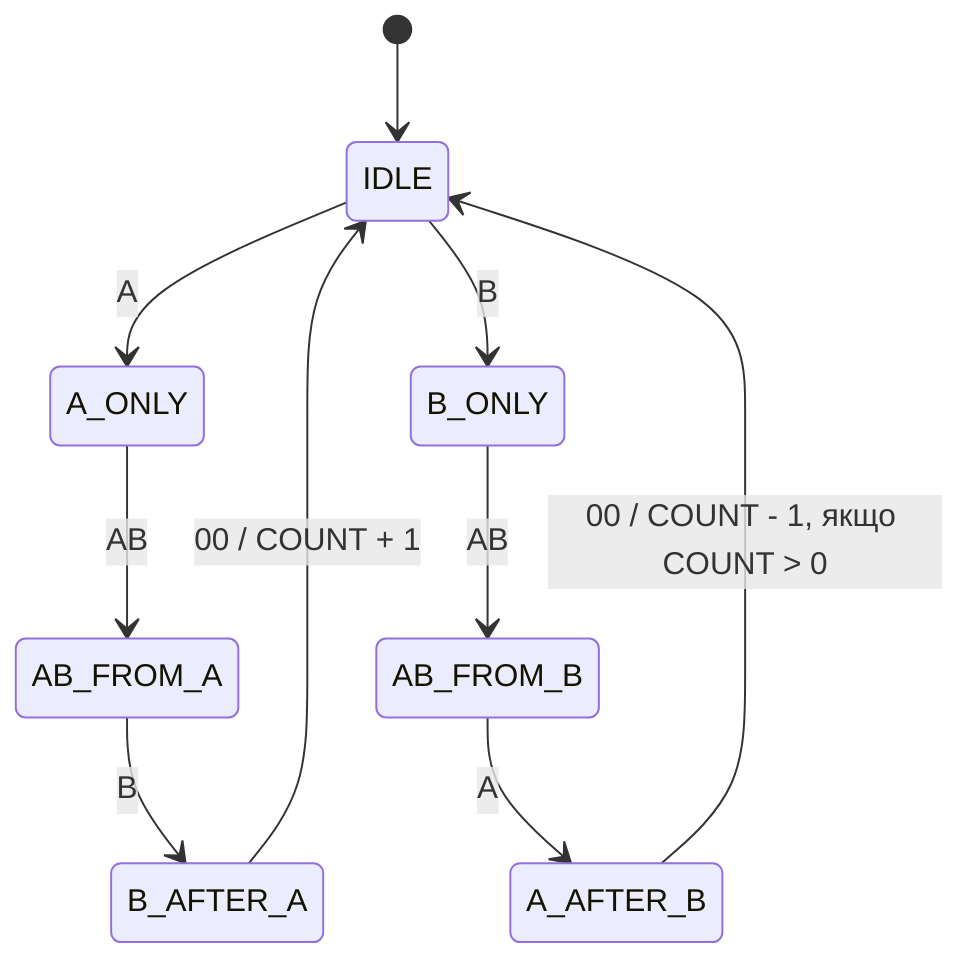
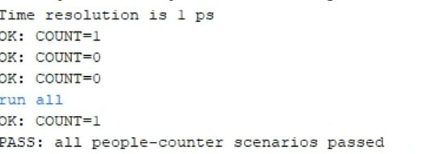
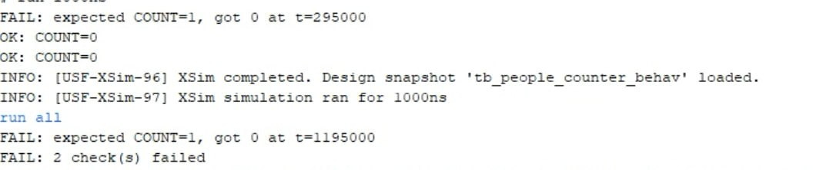
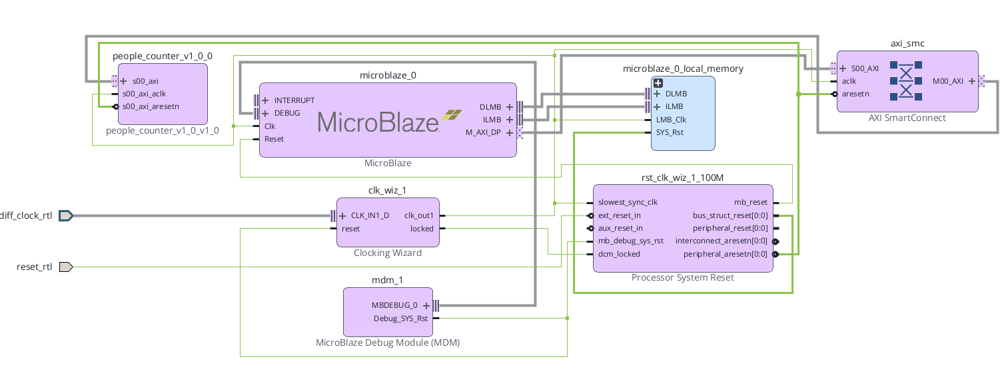
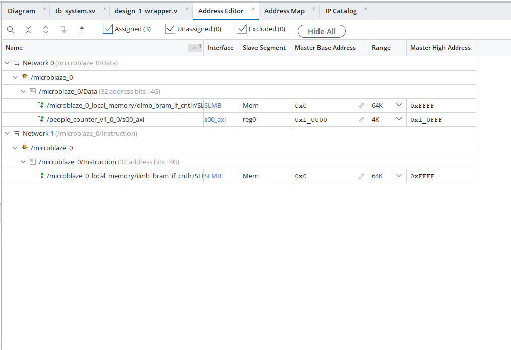
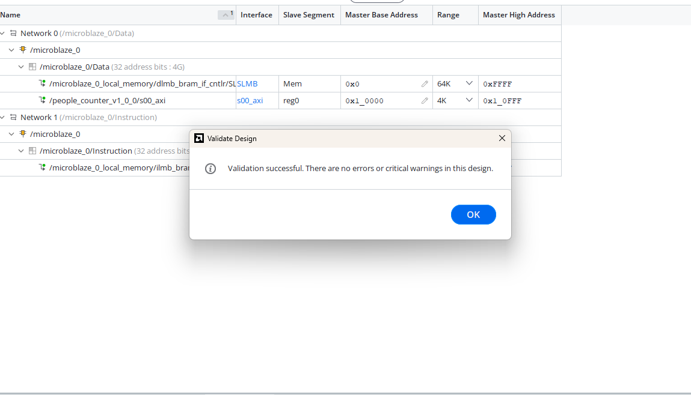
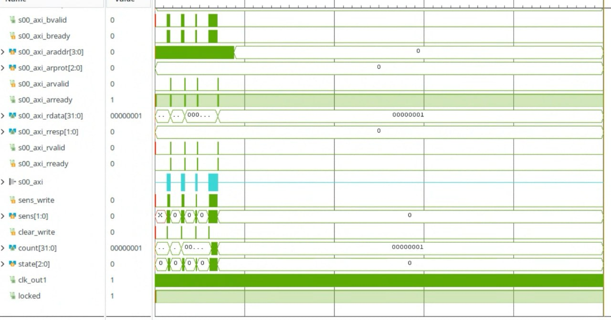
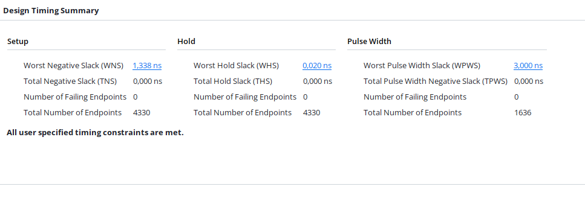
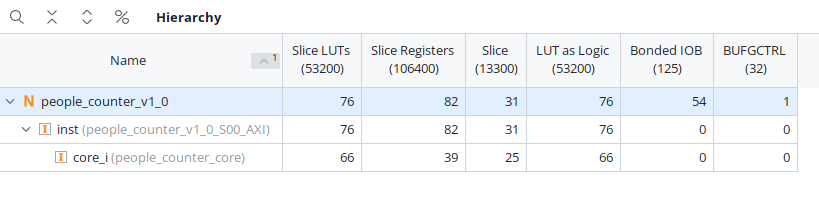

# Лічильник людей у дверях (people_counter) — AXI4-Lite IP для MicroBlaze

Курсовий проєкт з курсу FPGA. **Тема 4: Лічильник людей у дверях.**
Плата не використовувалась, усе перевірено в симуляції.

## 1. Що робить модуль

Модуль отримує стан двох датчиків у дверях: **A** (зовнішній) і **B** (внутрішній). Значення 1 означає, що датчик перекритий. Скінченний автомат відстежує послідовність змін датчиків і змінює лічильник на 1 лише після повного коректного проходу:

- прохід усередину: тільки A → обидва → тільки B → обидва вільні, лічильник **збільшується**;
- прохід назовні: тільки B → обидва → тільки A → обидва вільні, лічильник **зменшується** (але не нижче 0);
- будь-яка інша послідовність: лічильник не змінюється, автомат повертається в початковий стан IDLE.

Кожен запис у регістр SENS це один момент часу, тобто один такт роботи автомата.

## 2. Архітектура

```
програма на C → MicroBlaze → AXI4-Lite → people_counter_v1_0 (регістри) → people_counter_core (автомат + лічильник)
```

| Файл | Призначення |
|---|---|
| `people_counter_v1_0.v` | верхній рівень IP, проводка портів AXI4-Lite |
| `people_counter_v1_0_S00_AXI.v` | AXI4-Lite slave: прийом записів, читання COUNT, формування імпульсів `sens_write` і `clear_write` |
| `people_counter_core.v` | автомат проходу й лічильник |
| `tb_people_counter.v` | тестбенч модуля (без процесора), сам друкує PASS/FAIL |
| `people_counter_core_broken.v` | зламана копія для кроку 3 |
| `tb_system.sv` | системний тестбенч: лише такт і скидання |
| `people_counter.c` | програма на C для MicroBlaze |

Зовнішніх портів IP, крім шини AXI4-Lite, немає. Датчики емулює програма на C.

## 3. Таблиця регістрів

Усі регістри 32-бітні. Адреси відлічуються від базової адреси IP з Address Editor.

| Зсув | Назва | Доступ програми | Значення |
|---|---|---|---|
| `0x00` | SENS | запис | розряд [0]: датчик A, розряд [1]: датчик B, решта розрядів ігноруються. Кожен запис це один крок автомата |
| `0x04` | COUNT | читання | кількість людей у приміщенні, [31:0] |
| `0x08` | CTRL | запис | запис 1 у розряд [0] обнуляє лічильник і ставить автомат у IDLE; запис із розрядом [0]=0 нічого не робить |

Читання SENS і CTRL повертає 0. Запис у COUNT ігнорується. Адреса `0x0C` не використовується.

## 4. Автомат проходу

Позначення значень SENS: `00` обидва вільні, `A` = 01, `B` = 10, `AB` = 11.



Діаграма показує лише коректні переходи. Повна таблиця переходів (повторення того самого значення утримує стан, будь-яке інше значення скидає автомат у IDLE):

| Стан | `00` | `A` (01) | `B` (10) | `AB` (11) |
|---|---|---|---|---|
| IDLE | IDLE | A_ONLY | B_ONLY | IDLE |
| A_ONLY | IDLE | A_ONLY | IDLE | AB_FROM_A |
| AB_FROM_A | IDLE | IDLE | B_AFTER_A | AB_FROM_A |
| B_AFTER_A | IDLE, COUNT+1 | IDLE | B_AFTER_A | IDLE |
| B_ONLY | IDLE | IDLE | B_ONLY | AB_FROM_B |
| AB_FROM_B | IDLE | A_AFTER_B | IDLE | AB_FROM_B |
| A_AFTER_B | IDLE, COUNT−1 (якщо >0) | A_AFTER_B | IDLE | IDLE |

Проєктні рішення:

- Якщо датчик лишається перекритим кілька відліків поспіль, автомат утримує стан. Так враховано, що людина проходить повільніше, ніж іде опитування.
- Значення, яке порушило послідовність, лише повертає автомат у IDLE і не трактується як початок нового проходу.
- Одночасне перекриття обох датчиків зі стану IDLE (`11`) вважається помилковим і залишає автомат у IDLE.
- Зменшення COUNT захищене умовою `count != 0`, тому лічильник не переходить через нуль.
- Скидання (`resetn`) і запис CTRL[0]=1 однаково обнуляють лічильник і автомат.

## 5. Тестові сценарії

Очікувані значення пораховано вручну до запуску симуляції: кожну послідовність пройдено по таблиці переходів вище, і COUNT змінюється лише в переходах B_AFTER_A→IDLE (+1) та A_AFTER_B→IDLE (−1 при COUNT>0). Перед кожним сценарієм тестбенч пише 1 у CTRL.

| № | Сценарій | Послідовність SENS | Хід автомата | Очікуваний COUNT |
|---|---|---|---|---|
| 1 | Одна людина заходить | 00, 01, 11, 10, 00 | IDLE → A_ONLY → AB_FROM_A → B_AFTER_A → IDLE, +1 | **1** |
| 2 | Вихід із порожнього приміщення (граничний випадок) | 10, 11, 01, 00 | IDLE → B_ONLY → AB_FROM_B → A_AFTER_B → IDLE, але COUNT=0, зменшення блокується | **0** |
| 3 | Підійшла й повернулась | 01, 00 | IDLE → A_ONLY → IDLE, прохід не завершено | **0** |
| 4 | Двоє заходять, один виходить | (01, 11, 10, 00) ×2, потім 10, 11, 01, 00 | +1, +1, потім −1 | **1** |

Сценарій 2 перевіряє захист від переходу через нуль: без умови `count != 0` COUNT став би `0xFFFFFFFF`, і тестбенч показав би FAIL.

Результат запуску тестбенча модуля:

```
OK: COUNT=1
OK: COUNT=0
OK: COUNT=0
OK: COUNT=1
PASS: all people-counter scenarios passed
```



Програма на C перевіряє ті самі чотири сценарії з тими самими очікуваними значеннями (1, 0, 0, 1).

## 6. Зламана копія (крок 3)

Файл `people_counter_core_broken.v` має те саме ім'я модуля `people_counter_core`, тому підключається **замість** справжнього ядра, а не разом із ним. Помилка: при завершенні проходу всередину (стан `B_AFTER_A`, вхід `00`) замість `count <= count + 1` стоїть `count <= count`. Автомат проходить усі стани, але лічильник не росте.

Очікувана поведінка тестбенча на цій копії: падають сценарії 1 і 4 (очікувалось COUNT=1, прочитано 0), сценарії 2 і 3 проходять, бо в них COUNT і так має бути 0. Підсумок: `FAIL: 2 check(s) failed`.



## 7. Package IP, Block Design, системна симуляція

- IP упаковано через Package IP, репозиторій додано в IP Catalog. Зламана копія в пакет не входить.

  

- Block Design: MicroBlaze, пам'ять, тактовий сигнал, скидання, IP на шині AXI4-Lite. Validate Design пройдено успішно. Базова адреса IP в Address Editor: `0x0001_0000`, діапазон 4K (до `0x0001_0FFF`). Адреси регістрів: SENS `0x0001_0000`, COUNT `0x0001_0004`, CTRL `0x0001_0008`.

  
  
  

- Системна симуляція: `tb_system` лише подає такт і скидання, програму виконує MicroBlaze. На хвилях позначено записи в SENS і читання COUNT. Програма `people_counter.c` для кожного з чотирьох сценаріїв пише 1 в CTRL, потім емулює двері послідовністю записів у SENS, читає COUNT і порівнює з очікуваним значенням (1, 0, 0, 1). Результат PASS або FAIL друкується через `xil_printf` (за наявності UART у системі), а також видно за значеннями COUNT на хвилях.

  

## 8. Implementation (крок 7)

| Ресурс | Вся система (MicroBlaze + пам'ять + IP) | Лише IP `people_counter_v1_0` | З них ядро `people_counter_core` |
|---|---|---|---|
| LUT | 1366 | 76 | 66 |
| FF (регістри) | 1336 | 82 | 39 |
| DSP | 0 | 0 | 0 |

Цифри IP взято зі звіту Report Utilization (вкладка Hierarchy) для IP, синтезованого окремо як верхній модуль. Колонки Bonded IOB і BUFGCTRL у цьому звіті виникли лише через окремий синтез (порти AXI стали виводами) і до системи не належать. Цифри всієї системи взято з Design Runs для `impl_1`.

Результати Timing Summary після Implementation: WNS = 1,338 нс, WHS = 0,020 нс, TNS = THS = 0, критичних кінцевих точок 0 з 4330, WPWS = 3,000 нс.

Висновок про час: проєкт вкладається в час. WNS додатний (1,338 нс), тобто запас по setup є, а Vivado повідомляє, що всі задані обмеження виконано. Запас по hold додатний, але невеликий (0,020 нс).




## 9. Проблеми, які виникли, і як їх розв'язано

1. **Робота з шиною AXI4-Lite у Verilog.** Протокол AXI4-Lite має п'ять каналів із рукостисканням `valid`/`ready`, і потрібно було зрозуміти, у який момент адреса й дані вважаються прийнятими, коли формується відповідь `BVALID` і як не втратити транзакцію. Розв'язання: я вивчав готові приклади IP, згенеровані у Vivado (шаблон AXI4-Lite периферії), і дивився, як вони влаштовані. Також я користувався AI-асистентом, щоб розібратися з протоколом, а потім перевіряв логіку власним тестбенчем із записом і читанням регістрів.

2. **Логіка скінченного автомата проходу.** Складність була в тому, щоб розрізнити прохід усередину й назовні, коректно обробити некоректні послідовності (людина підійшла й повернулась, одночасне перекриття обох датчиків) і не дати лічильнику піти нижче нуля. Розв'язання: я спершу розписав усі переходи на папері у вигляді діаграми, потім переніс її в код і порахував вручну очікувані результати для тестових сценаріїв.

## 10. Структура репозиторію

```
.
├── README.md
├── .gitignore
├── docs/                       скриншоти з розділу 5 технічного завдання
├── people_counter/             IP
├── people_counter_app/         Vitis application (people_counter.c)
├── people_counter_platform/    Vitis platform
└── people_counter_system/      Vivado: Block Design і системна симуляція з IP
```
